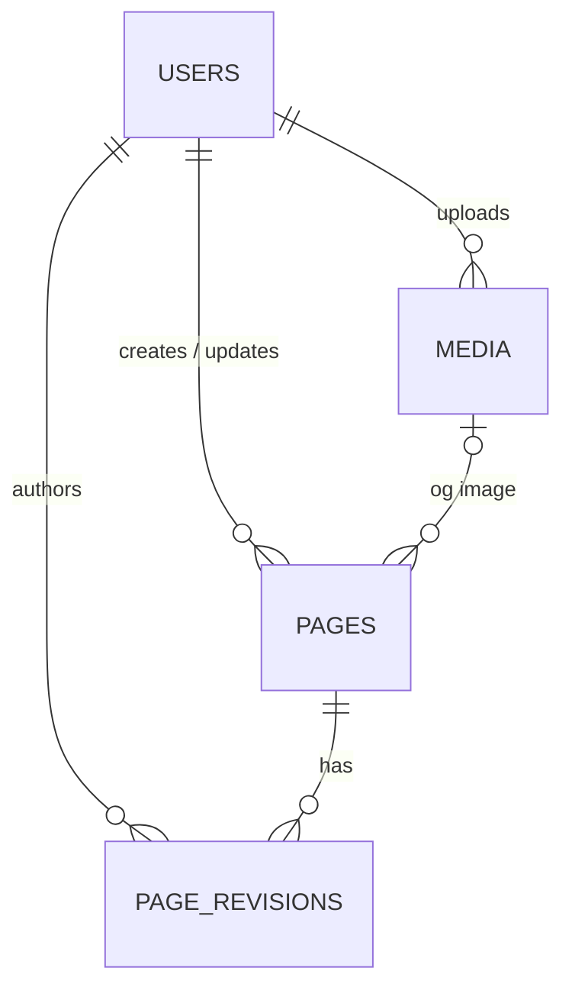

# Headless CMS & Page Management System

A full-stack headless CMS that lets non-technical staff create, edit, preview,
publish and manage website pages without changing code. Published content is
delivered through a Laravel REST API to a public-facing Vue 3 frontend.

> **Status:** In development. Milestones 01 to 09 complete; Milestone 10 (media library) in progress.

## Tech stack

| Layer      | Technology                                              |
| ---------- | ------------------------------------------------------- |
| Frontend   | Vue 3, TypeScript, Vite, Vue Router, Pinia, Tailwind CSS |
| Backend    | PHP 8.3+, Laravel, Laravel Sanctum, MySQL 8             |
| Testing    | Vitest, Vue Test Utils, PHPUnit/Pest                    |

## Planned features

- Page management with search, filtering and pagination
- Reusable content blocks (hero, rich text, image, CTA, card grid)
- Draft, preview, publish and unpublish workflow
- Media library with validated uploads
- Role-based access control (administrator, editor, viewer)
- Revision history with restore
- Public website that renders published pages dynamically

## Repository structure

headless-cms/
├── backend/ # Laravel API (added in Milestone 02)
├── frontend/ # Vue 3 + TypeScript app (added in Milestone 03)
├── .gitignore
└── README.md

## Setup

## Backend setup (Laravel 13)

Requires PHP 8.3+, Composer and MySQL 8.

    cd backend
    composer install
    cp .env.example .env
    php artisan key:generate
    # create a MySQL database and user, then set DB_* values in .env
    php artisan migrate
    php artisan serve

Health check: `GET http://127.0.0.1:8000/api/health`

## Data model

- **Content blocks** are stored as a validated JSON array on `pages.content`.
- **Roles** (`admin`, `editor`, `viewer`) are an enum column on `users`.
- **Revisions** are immutable snapshots with a per-page version number.
- `role`, `status` and `published_at` are not mass assignable.

Seed demo data locally with `php artisan migrate:fresh --seed`
(local development only; the seeder refuses to run in production).

## Authentication and roles

Cookie-based Laravel Sanctum authentication for the Vue SPA: an HttpOnly
session cookie plus a CSRF token. The SPA first calls `GET /sanctum/csrf-cookie`,
then `POST /api/login`. Failed logins are rate limited per email and IP.

| Role | Pages |
|------|-------|
| viewer | list and view |
| editor | viewer, plus create and update |
| admin | editor, plus delete |

Permissions are enforced server-side by `PagePolicy`, not only in the UI.
Use `localhost` (not `127.0.0.1`) in local URLs so cookies match. Required
settings are in `backend/.env.example`.

## API (admin, work in progress)

Authentication and authorisation are added in Milestone 06; until then these
routes are open and for local development only.

| Method | Endpoint | Description |
|--------|----------|-------------|
| GET | `/api/pages` | List pages (summaries). Params: `search`, `status`, `sort`, `per_page`, `page` |
| POST | `/api/pages` | Create a draft page |
| GET | `/api/pages/{id}` | Retrieve a page with its content blocks |
| PUT/PATCH | `/api/pages/{id}` | Update a page |
| DELETE | `/api/pages/{id}` | Delete a page |
| GET/POST | `/api/users` | List or create users (admin only) |
| GET/PUT/PATCH/DELETE | `/api/users/{id}` | View, update or delete a user (admin only) |
| POST | `/api/pages/{id}/publish` | Publish a page (editor or admin) |
| POST | `/api/pages/{id}/unpublish` | Unpublish a page (editor or admin) |
| GET | `/api/pages/{id}/preview` | Preview a page in the public format, any status (signed in) |
| GET | `/api/public/pages/{slug}` | A published page by slug (no login) |
| GET/POST | `/api/media` | List images, or upload one (multipart `file`, optional `alt_text`) |
| GET/PATCH/DELETE | `/api/media/{id}` | View an image, edit its alt text, or delete it (admin only) |

Responses use a `data` wrapper; lists add `links` and `meta`. Validation
errors return HTTP 422 with an `errors` object. `status` and `published_at`
cannot be set through these endpoints.

### Content blocks

A page's `content` is a list of `{ id, type, data }` blocks, validated and
rebuilt server-side: unknown types and undeclared fields are rejected or
dropped.

| Type | Data |
|------|------|
| `hero` | `heading`, `subheading`, `image_id`, `button_label`, `button_url` |
| `rich_text` | `markdown` (source) and `html` (generated by the server; render this) |
| `image` | `image_id`, `alt`, `caption` |
| `cta` | `heading`, `text`, `button_label`, `button_url`, `style` |
| `card_grid` | `heading`, `cards[]` (`title`, `text`, `image_id`, `link_label`, `link_url`) |

- Rich text is Markdown. Raw HTML is stripped, unsafe link schemes are
  neutralised and images are replaced by their alt text.
- URLs must be `http(s)://`, `mailto:`, `/relative` or `#anchor`.
- Plain-text fields are stored verbatim: clients must escape them on output.
- Updates may send `updated_at`; a stale value returns `409 Conflict`.

### Publishing

- Pages start as drafts. Publishing is a separate action: `status` and
  `published_at` cannot be set through the normal create and update endpoints.
- To publish, the saved page needs at least one block, and every image block
  needs an image. Publishing and unpublishing are safe to repeat.
- Editing a published page updates the live page immediately.
- `GET /api/public/pages/{slug}` returns published pages only. Drafts,
  unpublished and unknown slugs all return the same 404. The response contains
  only public fields (no `id`, `status` or audit columns) and, for rich text,
  only the generated `html`. It is rate limited, never sets a cookie, and
  sends an `ETag` with `Cache-Control: public, no-cache`, so caches
  revalidate on every request and unpublishing takes effect immediately.
- `GET /api/pages/{id}/preview` shows the saved content of any page in the
  public format to signed-in users, with `Cache-Control: no-store` and
  `X-Robots-Tag: noindex`.
- Browsers on other origins are blocked by CORS: only the configured frontend
  origin may call this API.

  ### Media library

- Uploads accept **JPEG, PNG and WebP only**, up to 5 MB and 16 megapixels. The
  type is detected from the file's contents, not its name.
- Every upload is **decoded and re-encoded by the server**, which strips
  metadata (including GPS location), removes anything hidden in the file and
  rejects corrupt or disguised files. Images over 2560 px are scaled down and a
  480 px thumbnail is created.
- Files are stored under random names on the `public` disk. The original
  filename is kept only as display text.
- Editors and admins can upload and edit alt text. Only admins can delete, and
  an image that a page still uses cannot be deleted.
- The public page API returns each image as `{ url, thumbnail_url, width,
  height, alt }` next to its `image_id`.
- Uploads are limited to 30 per minute per user.

**Requirements:** PHP `gd`, `exif` and `fileinfo` extensions; a writable upload
temp folder; `upload_max_filesize` of at least 6M, `post_max_size` of at least
8M and `memory_limit` of at least 256M; and `php artisan storage:link` once per
environment.

**Not included (future work):** virus scanning, storage quotas, cropping, PDFs
and other document types, and cloud storage (set `MEDIA_DISK`).

## Frontend setup (Vue 3 + TypeScript)

Publishing controls and a draft preview in the page editor, plus block-rendering components (reused by the public site).

Admin: http://localhost:5173/admin (needs the backend running at http://localhost:8000).
Admin screens: page list (search, filter, pagination) and user management (admin only)

Requires Node.js LTS and npm.

    cd frontend
    npm install
    cp .env.example .env
    npm run dev

Run tests with `npm run test:unit` and build with `npm run build`.