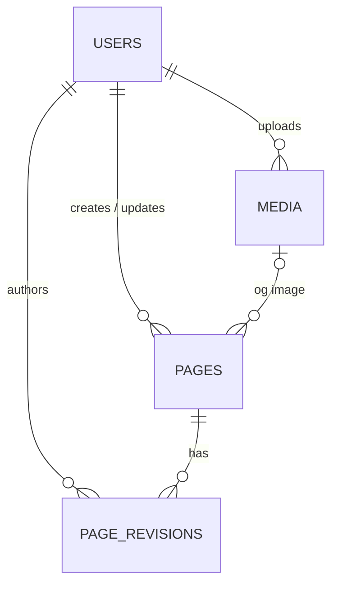

# Headless CMS & Page Management System

A full-stack headless CMS that lets non-technical staff create, edit, preview,
publish and manage website pages without changing code. Published content is
delivered through a Laravel REST API to a public-facing Vue 3 frontend.

>> **Status:** In development. Milestones 01 to 04 (setup, backend, frontend, database schema) complete.

## Tech stack

| Layer      | Technology                                              |
| ---------- | ------------------------------------------------------- |
| Frontend   | Vue 3, TypeScript, Vite, Vue Router, Pinia, Tailwind CSS |
| Backend    | PHP 8.3+, Laravel, Laravel Sanctum, MySQL 8             |
| Testing    | Vitest, Vue Test Utils, PHPUnit/Pest                    |

## Planned features

- Page management with search, filtering and pagination
- Reusable content blocks (hero, rich text, image, CTA, card grid)
- Draft, preview, publish and unpublish workflow
- Media library with validated uploads
- Role-based access control (administrator, editor, viewer)
- Revision history with restore
- Public website that renders published pages dynamically

## Repository structure

headless-cms/
├── backend/ # Laravel API (added in Milestone 02)
├── frontend/ # Vue 3 + TypeScript app (added in Milestone 03)
├── .gitignore
└── README.md

## Setup

## Backend setup (Laravel 13)

Requires PHP 8.3+, Composer and MySQL 8.

    cd backend
    composer install
    cp .env.example .env
    php artisan key:generate
    # create a MySQL database and user, then set DB_* values in .env
    php artisan migrate
    php artisan serve

Health check: `GET http://127.0.0.1:8000/api/health`

## Data model

- **Content blocks** are stored as a validated JSON array on `pages.content`.
- **Roles** (`admin`, `editor`, `viewer`) are an enum column on `users`.
- **Revisions** are immutable snapshots with a per-page version number.
- `role`, `status` and `published_at` are not mass assignable.

Seed demo data locally with `php artisan migrate:fresh --seed`
(local development only; the seeder refuses to run in production).

## Frontend setup (Vue 3 + TypeScript)

Requires Node.js LTS and npm.

    cd frontend
    npm install
    cp .env.example .env
    npm run dev

Run tests with `npm run test:unit` and build with `npm run build`.